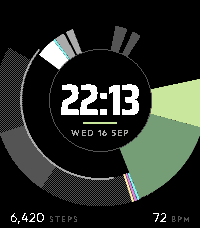
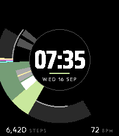

# Reconstruction

Pebble Time 2 向けウォッチフェイス「Disc」。暗い金属の円盤に光沢が走るグラフィックで、ライムの扇が分を、白く光る鏡面が時を指します。

| 22:13 | 07:35 |
|---|---|
|  |  |

## 表示

| 要素 | 内容 |
|---|---|
| ライムの扇 | 分。中心から外周まで届き、先端が分を指す |
| 鏡面のくさび | 時。内円を回り、白い先端が時を指す |
| 中心 | 時刻(24h / 12h は時計の設定に従う)と日付 |
| 下段 | 今日の歩数と心拍数 |

扇と鏡面の開き方は時刻ごとに決まっていて、同じ時刻なら常に同じ形になります。秒表示とアニメーションはなく、更新は毎分1回です。

## 状態表示

| 状態 | 表示 |
|---|---|
| Bluetooth 切断 | 分の扇がグレーになる(短いバイブ1回)。再接続で戻る |
| 電池 20% 以下 | 中心の円の縁が赤紫になる |
| 歩数・心拍が取れない | `--` |

心拍は時計を装着していて計測済みのときだけ表示されます。

## 対応機種

- Pebble Time 2(platform `emery`、200×228、64色)のみ

## インストール

1. [Releases](../../releases) から `reconstruction-<version>.pbw` をスマホにダウンロードする
2. ダウンロードした `.pbw` を Pebble アプリで開く(ファイルアプリやブラウザのダウンロード一覧からタップ)
3. 時計にインストールされたらウォッチフェイスとして選ぶ

## ビルド

[pebble-tool](https://developer.repebble.com/sdk)(Core Devices 版)と SDK が必要です。

```sh
pebble build                       # build/ に .pbw を出す
pebble install --emulator emery    # エミュレータで確認
```

`v*` タグを push すると GitHub Actions がビルドして Release に添付します。タグと `package.json` の `version` が一致している必要があります。

## フォント

| 用途 | フォント |
|---|---|
| 時刻 | [Saira](https://fonts.google.com/specimen/Saira)(字幅 75・ウェイト 800) |
| 日付・ラベル・数値 | [Outfit](https://fonts.google.com/specimen/Outfit)(ウェイト 600 / 400) |

Pebble は可変フォントの既定インスタンスしか使わないため、`resources/fonts/source/` の可変フォントから軸を固定した TTF を生成して同梱しています。ウェイトや字幅を変えるときは `resources/fonts/instances.json` を編集して再生成します。

```sh
uv run scripts/build-fonts.py
```

いずれも SIL Open Font License。ライセンス全文は `resources/fonts/` にあります。

## ライセンス

コードは [MIT License](LICENSE)。`resources/fonts/` 以下のフォント(生成した静的 TTF を含む)は各 OFL に従います。
